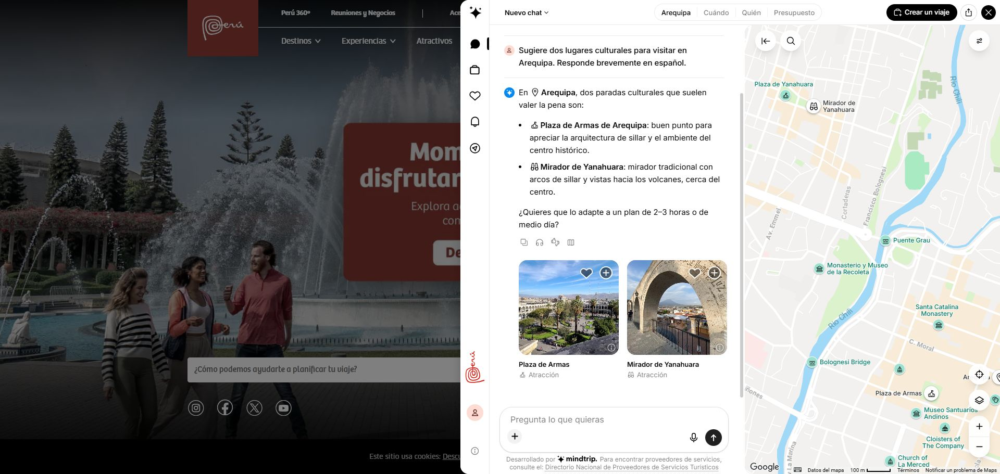

# Global LLM Atlas review for 2026-11-13

Version **0.10.0** covers **105 access points, 104 unique services and 50 country associations**. The catalog has 64 ACTIVE, 2 LIMITED and 39 UNVERIFIED entries. Android metadata covers 41 native or regional app listings, two integrations and one unique PWA service.

## Catalog additions

| Entry | Evidence | Android |
|---|---|---|
| Planifica Tu Viaje (PROMPERÚ), Peru | The official Peru.travel portal embeds a Mindtrip travel assistant launched in April 2026. A Spanish prompt requesting two cultural sites in Arequipa returned Plaza de Armas and Mirador de Yanahuara with explanations and map cards. The test required no sign-in or payment. | The similarly named Google Play app comes from AppAi Labs. Mindtrip advertises its iOS app. Official Android distribution of the PROMPERÚ deployment remains unverified. |
| Google Search AI Mode, United States | Google documents conversational follow-up, Spanish and access in Peru. The official route opened the Spanish question composer in a browser already signed in to Google. Marked UNVERIFIED because a model response and anonymous access remain untested. | Google documents the integration in its Google app. The Google Play publisher is Google LLC. App installation and account entitlements remain untested. |

The Peru association for Planifica Tu Viaje reflects the PROMPERÚ and MINCETUR deployment. The provider is Mindtrip, and its underlying model identity and training origin remain unverified. Use **Planifica Tu Viaje** in the portal to open the assistant.

Sources for the additions:

- [Peru.travel portal](https://www.peru.travel/es) · [Peru.travel launch note](https://www.peru.travel/es/noticias/peru-da-el-siguiente-paso-con-el-asistente-virtual-de-viajes-con-ia-en-peru-travel) · [PROMPERÚ announcement](https://www.gob.pe/institucion/promperu/noticias/1375589-mincetur-y-promperu-lanzan-asistente-virtual-con-inteligencia-artificial-para-planificar-viajes-al-peru)
- [Mindtrip iOS listing](https://mindtrip.ai/ios) · [Similarly named Android app](https://play.google.com/store/apps/details?id=com.travel.mindtrip)
- [Google Search Help in Spanish](https://support.google.com/websearch/answer/16011537?co=GENIE.Platform%3DDesktop&hl=es-LA) · [Android access and supported countries](https://support.google.com/websearch/answer/16011537?co=GENIE.Platform%3DAndroid&hl=EN) · [Google on Play](https://play.google.com/store/apps/details?id=com.google.android.googlequicksearchbox)

## Model announcements and catalog decisions

| Announcement | Catalog treatment |
|---|---|
| Gemini 4 Hydrogen, November 12 | Google announced it for all Gemini app and AI Studio tiers and for AI Mode in Search. Updated the existing service metadata and the new Search entry. Account quotas and model selection remain untested. [Google model announcement](https://blog.google/innovation-and-ai/models-and-research/gemini-models/introducing-gemini-4-hydrogen/) · [Google Search update](https://blog.google/products-and-platforms/products/search/gemini-4-hydrogen-search-upgrade/) |
| Gemini 4 Carbon, November 10 | Google announced consumer access for AI Ultra subscribers and paid developer API access via AI Studio. Added plan details to the existing Gemini and AI Studio records. [Google announcement](https://blog.google/innovation-and-ai/models-and-research/gemini-models/gemini-4-carbon-now-available/) |
| Qwen4-Max Preview and ERNIE 5.5 Flash Preview | Alibaba Cloud documents Qwen4-Max under Token Plan. Baidu documents its ERNIE preview on Qianfan. Added provider notes to the existing records. Availability in free consumer chat remains unverified for both. [Alibaba Cloud](https://www.alibabacloud.com/help/en/model-studio/qwen4-max-preview) · [Baidu Cloud](https://cloud.baidu.com/product/qianfan_home/model_3.html) |
| QVAC BotPsy, November 11 | The primary launch documents downloadable weights for local use. No hosted public conversation for this model was verified. [Tether QVAC](https://qvac.tether.io/blog/on-device-ai-agent-botpsy) |

## Peru follow-up

- **UNEBOT** joins the research and deployment watchlist. The UNE announced an assistant backed by institutional information. An indexed university page shows a text input, while the independent browser check was inconclusive. [UNE announcement](https://www.une.edu.pe/uneweb/une-implementa-unebot-chatbot-institucional-basado-en-ia/) · [Institutional page](https://www.une.edu.pe/uneweb/politica-y-objetivos-de-la-calidad/)
- **Jeimy AI** advertises Colibrí with limited free access and mobile web use. **Theus** advertises its Free plan. Both tracked URLs responded with HTTP 200. The current review did not confirm successful conversations or attributable Android apps. [Jeimy](https://jeimy.ai/chat) · [Theus](https://theus.pe/precios/)
- **CatIA** again redirected to a restricted-access page. Its HTTP 200 reflects that page. [CatIA](https://catalogoia.servicios.gob.pe/catia)

## URL checks for the prior catalog

Automated GET requests to the **103 pre-existing entries** yielded **96 HTTP 200 responses**, six other HTTP responses and one request without a response. The seven are Augure, Crystal, ChatyfAI, Meta AI, Wrtn, Cladik and ASI GovGPT. These checks record transport results. Existing service statuses are based on their own evidence. The table omits redirect query parameters.

| Entry | HTTP | Requested URL | Observed redirect |
|---|---:|---|---|
| de-textcortex | 200 | https://app.textcortex.com/c | — |
| de-privatemode-chat | 200 | https://chat.privatemode.ai/ | — |
| ar-aki-agent | 200 | https://aki.ar/projects?projectId=3672 | — |
| at-comfyai | 200 | https://comfyai.de/app/ | — |
| br-maritaca | 200 | https://chat.maritaca.ai/ | — |
| bg-bggpt | 200 | https://bggpt.ai/ | — |
| ca-cohere | 200 | https://dashboard.cohere.com/playground/chat | https://dashboard.cohere.com/welcome/login |
| ca-chat-jimmy | 200 | https://chatjimmy.ai/ | — |
| ca-augure | — | https://chat.augureai.ca/chat | — |
| cl-copuchat | 200 | https://copuchat.latamgpt.org/ | — |
| cn-deepseek | 200 | https://chat.deepseek.com/ | — |
| cn-dola | 200 | https://www.dola.com/chat | — |
| cn-ernie | 200 | https://ernie.baidu.com/ | — |
| cn-kimi-ai | 200 | https://www.kimi.com/chat/history | — |
| cn-manus | 200 | https://manus.im/app | — |
| cn-minimax | 200 | https://www.minimax.io/ | — |
| cn-qwen | 200 | https://chat.qwen.ai/ | — |
| cn-xiaomi-mimo-studio | 200 | https://aistudio.xiaomimimo.com/ | — |
| cn-z-ai | 200 | https://chat.z.ai/ | — |
| cn-tencent-ai-studio | 200 | https://aistudio.tencent.com/ | — |
| cn-tencent-ai-studio-international | 200 | https://aistudio.tencent.ai/ | — |
| ec-yachaq-ai | 200 | https://yachaq.ai/ | — |
| ae-falcon-llm-chat | 200 | https://chat.falconllm.tii.ae/anonymous-chat | — |
| es-luzia | 200 | https://chat.luzia.com/es | — |
| fr-le-chat | 200 | https://chat.mistral.ai/chat | — |
| id-sahabat-ai | 200 | https://chat.sahabat-ai.com/ | — |
| it-crystal | 503 | https://agent.crystal.ai/ | — |
| it-chatminerva | 200 | https://chatminerva.org/ | — |
| jp-felo | 200 | https://felo.ai/es/search | — |
| ma-chatyfai | 521 | https://chatyfai.com/en/chat | — |
| no-bineric-chat | 200 | https://chat.bineric.com/ | — |
| nl-loes | 200 | https://chat.loes.ai/ | — |
| pl-pllum-chat | 200 | https://pllum.clarin-pl.eu/pllum_8x7b | — |
| ru-alice-yandex | 200 | https://alice.yandex.ru/ | — |
| ru-gigachat | 200 | https://giga.chat/ | — |
| sg-sea-lion-playground | 200 | https://playground.sea-lion.ai/chat | https://playground.sea-lion.ai/auth/signin |
| ch-lumo | 200 | https://lumo.proton.me/ | — |
| ch-public-ai | 200 | https://chat.publicai.co/ | — |
| us-chatgpt | 200 | https://chatgpt.com/ | — |
| us-claude | 200 | https://claude.ai/new | — |
| us-copilot | 200 | https://copilot.microsoft.com/ | https://copilot.com/ |
| us-gemini | 200 | https://gemini.google.com/app | — |
| us-google-ai-studio | 200 | https://aistudio.google.com/ | https://aistudio.google.com/welcome |
| us-grok | 200 | https://grok.com/ | — |
| us-ibm-granite-playground | 200 | https://www.ibm.com/granite/playground | — |
| us-laguna | 200 | https://chat.poolside.ai/ | — |
| us-meta-ai | 403 | https://www.meta.ai/ | — |
| us-monkey-code | 200 | https://monkeycode-ai.net/ | — |
| us-morphic | 200 | https://chat.morphic.sh/ | — |
| us-notebooklm | 200 | https://notebooklm.google.com/ | https://notebook.google.com/ |
| us-perplexity | 200 | https://www.perplexity.ai/ | — |
| us-pi | 200 | https://pi.ai/ | https://pi.ai/redirect |
| us-textcortex | 200 | https://app.textcortex.com/user/dashboard/chat | — |
| us-venice | 200 | https://venice.ai/chat | — |
| us-you-com | 200 | https://you.com/ | — |
| uz-coreai-chat | 200 | https://chat.coreai.uz/ | — |
| eg-chat-got | 200 | https://chat-got.ai/ | — |
| kr-wrtn | 402 | https://wrtn.ai/ | — |
| my-ilmuchat | 200 | https://www.ilmu.ai/ilmuchat/ | — |
| sa-humain-chat | 200 | https://chat.humain.ai/ | https://chat.humain.com/ |
| se-lovable | 200 | https://lovable.dev/ | — |
| lt-hostinger-ai-builder | 200 | https://www.hostinger.com/ai-builder | — |
| il-base44 | 200 | https://base44.com/ | — |
| uy-zapia | 200 | https://zapia.com/ | https://zapia.com/ |
| pk-pakbot | 200 | https://www.pakbot.online/ | — |
| pk-warisha | 200 | https://warishaai.com/ | — |
| bd-moyna | 200 | https://moyna.ai/en | — |
| bd-assistant | 200 | https://assistant.bd/ | — |
| kh-angkorai | 200 | https://www.angkorai.ai/ | — |
| np-guffgpt | 200 | https://guffgpt.com/ | — |
| np-shree | 200 | https://ai.meetshree.com/ | — |
| lk-cladik | 503 | https://cladik.com/ | — |
| pe-jeimy | 200 | https://jeimy.ai/app | — |
| us-liquid-playground | 200 | https://playground.liquid.ai/ | https://playground.liquid.ai/sign-in |
| in-gnani-evon | 200 | https://playground.gnani.ai/ | — |
| us-asta | 200 | https://asta.allen.ai/ | — |
| gb-gb1 | 200 | https://gb1.ai/ | — |
| us-arcee-chat | 200 | https://chat.arcee.ai/ | — |
| in-indus | 200 | https://indus.sarvam.ai/ | https://indus.sarvam.ai/login |
| cn-longcat | 200 | https://longcat.ai/ | — |
| cn-stepfun | 200 | https://chat.stepfun.com/chats/new | — |
| pl-bielik-chat | 200 | https://chat.bielik.ai/ | https://id.speakleash.org.pl/auth/realms/SpeakLeash/protocol/openid-connect/auth |
| pe-catia | 200 | https://catalogoia.servicios.gob.pe/catia | https://catalogoia.servicios.gob.pe/acceso-restringido |
| ch-mate | 200 | https://app.swissmate.ai/ | https://app.swissmate.ai/login |
| ch-euria | 200 | https://euria.infomaniak.com/ | — |
| za-ng-ai | 200 | https://ng-ai.co.za/ | — |
| ca-labiba | 200 | https://www.olabiba.com/ | — |
| ng-govguide | 200 | https://govguide.ng/chat | — |
| at-eustella | 200 | https://app.eustella.com/ | — |
| th-typhoon | 200 | https://playground.opentyphoon.ai/ | https://playground.opentyphoon.ai/auth/sign-in |
| us-duck-ai | 200 | https://duck.ai/ | — |
| za-chanua | 200 | https://chanua.hsrc.ac.za/ | — |
| pe-theus | 200 | https://theus.pe/ | — |
| ug-sunflower | 200 | https://sunflower.sunbird.ai/ | — |
| nz-asi-govgpt | 403 | https://chat.asi.nz/ | — |
| si-alma | 200 | https://www.slovenia.info/en/ | https://www.slovenia.info/en |
| pt-gov-pt-assistant | 200 | https://www.gov.pt/ | — |
| tn-tunai | 200 | https://tunai.tn/ | — |
| et-bini | 200 | https://www.bina.et/ai | https://bina.et/ai |
| et-addisgpt | 200 | https://app.addisgpt.ai/ | — |
| pe-yachaibot | 200 | https://yachaibot.servicios.gob.pe/normativas/ | — |
| qa-fanar | 200 | https://chat.fanar.qa/ | — |
| us-poe | 200 | https://poe.com/ | https://poe.com/login |
