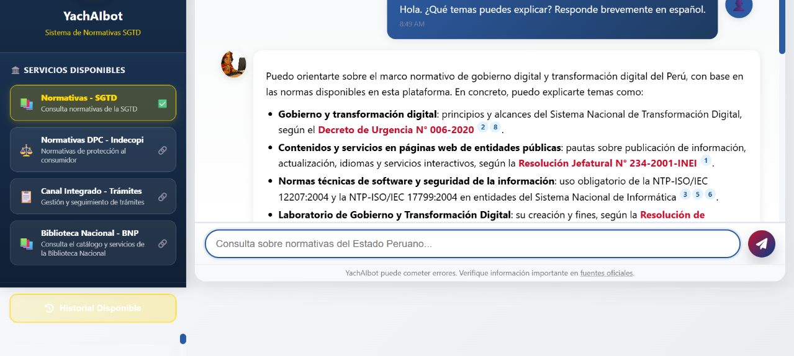

# Evidence and maintenance review — 2026-11-09

## Release decision

Version **0.9.0**: **103 access points**, **102 unique services**, **50 country/project associations**, **63 ACTIVE**, **2 LIMITED**, and **38 UNVERIFIED**. Android: **44 metadata records** representing **41 native/regional apps**, **one unique PWA service** (two cross-list records) and **one integrated service**.

The review combines automated transport checks of all 100 existing service URLs, primary-source discovery across regions, selected normal-browser inspection and one successful anonymous conversation. It is not an exhaustive worldwide census or a conversation retest of all catalog services. Existing lifecycle states and verification dates are retained unless an explicitly documented test supports a change.

## New entries

| Entry | Evidence and decision | Android |
|---|---|---|
| YachAIbot (PCM/SGTD), Peru | Official state-domain portal links its Spanish normative assistant. One anonymous prompt produced a relevant answer with document references; **ACTIVE**. Institutional retrieval service, not evidence of a Peruvian foundation model. | No attributable dedicated app verified; YanApp is another service. |
| Fanar, Qatar | QCRI/HBKU project, official free-access statement, direct web chat and official English-language support. Chrome rendered prompt controls and sign-in. **UNVERIFIED** pending a successful conversation; registration requirements not established. | Official `com.fanarmobile`, Hamad Bin Khalifa University. |
| Poe, United States | Quora platform; official FAQ confirms renewing daily points for non-paying users and English/Spanish use. Entry leads to sign-in. **UNVERIFIED** pending an authenticated conversation. Country follows the operator, not every underlying model. | Official `com.poe.android`, Quora, Inc. |

Fanar and Poe are newly cataloged here, not claims of new launches. Both Android records establish attributable store distribution only: no APK extraction, installation, signature audit or availability from Peru was tested. Unknown non-text capabilities remain null rather than copied from promotional feature lists.

### YachAIbot conversation evidence

- Date: **9 November 2026, approximately 08:49–08:50 Lima time**, normal Chrome session.
- Entry: https://yachaibot.servicios.gob.pe/normativas/
- Prompt: `Hola. ¿Qué temas puedes explicar? Responde brevemente en español.`
- Result: a Spanish explanation covering digital-government norms, institutional website rules, software/security standards and the digital-government laboratory, with document and SPIJ references.
- No registration, payment or personal data was required for this test.
- Limits: one short functional test; cited legal content was not audited and the other entity assistants were not conversation-tested. The main portal advertises multiple tools, including decision trees and internal dashboards; these are not counted as separate LLM services.

Primary sources:
- https://yachaibot.servicios.gob.pe/
- https://yachaibot.servicios.gob.pe/normativas/
- https://www.fanar.qa/en
- https://www.hbku.edu.qa/en/web-summit-2026/technologies/fanar
- https://chat.fanar.qa/
- https://play.google.com/store/apps/details?id=com.fanarmobile
- https://poe.com/
- https://help.poe.com/hc/en-us/articles/19944206309524-Poe-FAQs
- https://poe.com/download
- https://play.google.com/store/apps/details?id=com.poe.android

## Existing service changes

| Service | Finding and recorded action |
|---|---|
| Mistral | Official help, product and Google Play pages now use **Vibe**, formerly Le Chat. Updated name and Android note, preserved stable ID `fr-le-chat`, chat entry and historical conversation-verification date. Free everyday use remains advertised; advanced agent features depend on plan. |
| Mistral Large 4 | Official open-weight announcement supersedes the earlier pending-release finding. Recorded a new dated provenance item without asserting consumer-chat model selection or reproducing inference. |
| Sahabat-AI | `/dashboard` returned 404 while the root on the same official host returned the branded application with HTTP 200. Corrected entry URL to root. No fresh conversation or lifecycle change claimed. |
| Jeimy AI, Peru | Official page still describes free limited Colibrí plus Águila/Apu. `/app` returned 200, but a successful conversation, independent model-training provenance and official native Android app remain unconfirmed. |
| Theus, Peru | Current publisher pricing still includes Free without a card and usage renewal windows of five hours/seven days. No authenticated conversation or Android installation performed. |
| CatIA, Peru | Again redirected to the authorized-access restriction page. Retain UNVERIFIED; do not interpret a 200 restriction page as public chat or as permanent shutdown. |
| Duck.ai | Chrome rendered a Free Spanish anonymous prompt interface. No prompt was submitted: the interface explicitly associates submission with acceptance of terms. Retain UNVERIFIED. |

Sources:
- https://help.mistral.ai/en/articles/682992-le-chat-is-now-vibe
- https://mistral.ai/products/vibe/
- https://play.google.com/store/apps/details?id=ai.mistral.chat
- https://mistral.ai/news/mistral-large-4-oss/
- https://chat.sahabat-ai.com/dashboard
- https://chat.sahabat-ai.com/
- https://jeimy.ai/
- https://theus.pe/precios/
- https://catalogoia.servicios.gob.pe/catia
- https://duck.ai/

## Discovery leads not added

| Lead / region | Reason |
|---|---|
| Ghana-GPT, Ghana | Official page says coming soon and requests knowledge contributions. A future free plan is not a presently verified public chat. https://ghana-gpt.com/ |
| TheAI / Alishan, Taiwan | English presentation material exists, but English/Spanish chat operation and reliable direct access were not established. https://chat.theai.tw/ ; https://www.theai.tw/en/guide/theai-alishan-taiwan-ai |
| GaMS, Slovenia | Previous language/access gate remains unresolved; no newly reproduced English/Spanish chat. https://www.cjvt.si/projekti/gams/ |
| HuggingChat | Current interface is reachable; free-tier conditions and the effect of its earlier closure/relaunch were not resolved sufficiently for this pass. https://huggingface.co/chat/ |
| Ayva, Czechia | Official page describes closed Android testing and a time-limited trial. Not a qualifying public web service with ongoing free access. https://ayvaai.com/en |
| asistentul.ai, Romania | Official free offering is a seven-day trial; ongoing free tier and English/Spanish operation not established. https://asistentul.ai/ |
| CakeAI and earlier curator exclusions | Preserve the October 23 decision; discovery snippets do not override curator-reported instability. https://vinaphone.cakeai.vn/en ; see [earlier decision](curation-v0.5.0-2026-10-23.md). |
| MeliMate / Latin America | Early-access signup and external-AI integration do not establish a qualifying independent public conversational web service. https://melimate.ai/ |

The separate 14-record Peru research/deployment watchlist is unchanged. None of these findings establishes a newly released independent Peruvian foundation model. Existing academic artifacts and WhatsApp-only deployments retain their previous classifications.

## Transport audit

[All 100 pre-existing URLs and redirects](url-check-2026-11-09.md) are recorded. **94 returned HTTP 200**; the remaining six returned **404 (1), 503 (2), 403 (2), 402 (1)**. Responses are environment-dependent. Bot restrictions, authentication, soft failures and restricted-access pages prevent treating HTTP results as service lifecycle truth. The three additions were separately reviewed and are outside the 100-URL baseline.

## Publication repairs and validation

The previous final Pages run, [41668369417](https://github.com/Renzo-BD/global-llm-atlas/actions/runs/41668369417), failed at `data/android.csv: JSON/CSV mismatch`. The JSON had 42 Android records but the CSV only 41: AddisGPT was absent. Regenerating both exports repairs the publication blocker; `scripts/export_csv.py` makes the operation reproducible.

The site still displayed v0.7.0 and lacked map coordinates for Uganda, New Zealand, Slovenia, Portugal, Tunisia and Ethiopia despite their v0.8.0 data records. Current snapshot displays are synchronized, those six markers restored and Qatar added. Android row cells now use the actual Web-column position; the previous fixed index placed them under the wrong headers.

Validation covers both schemas, unique IDs, duplicate targets, Android references, exact JSON/CSV parity, shared release metadata, map coverage and JavaScript syntax. Publication and Pages deployment status must be checked separately after pushing the reviewed commit.
